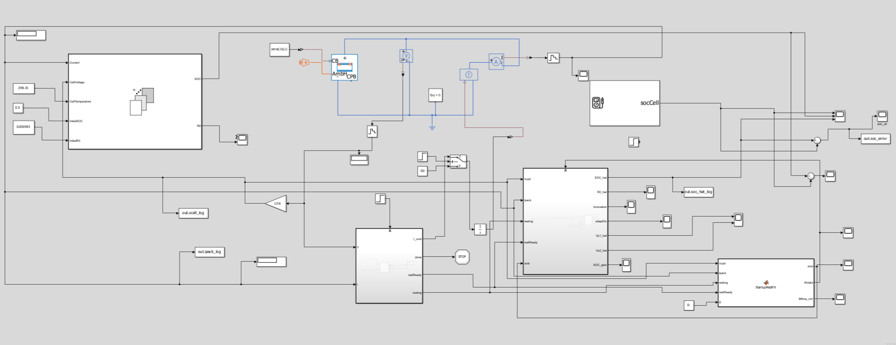
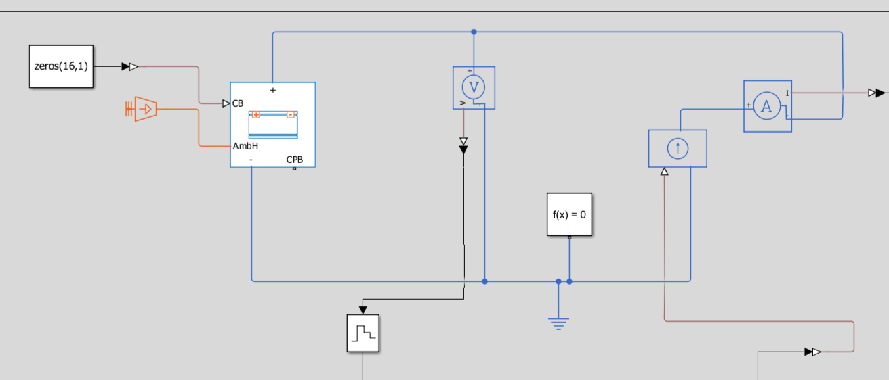
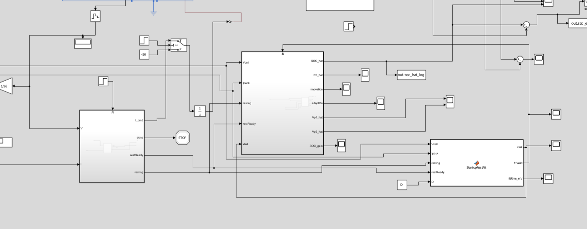
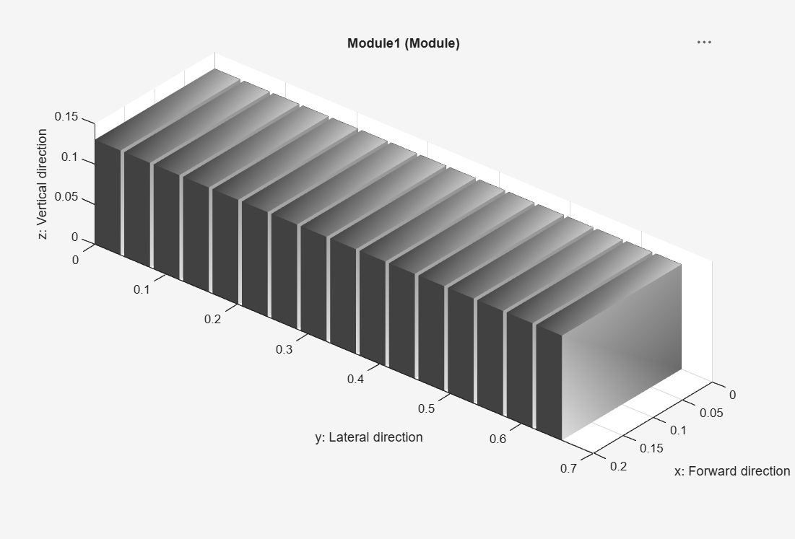
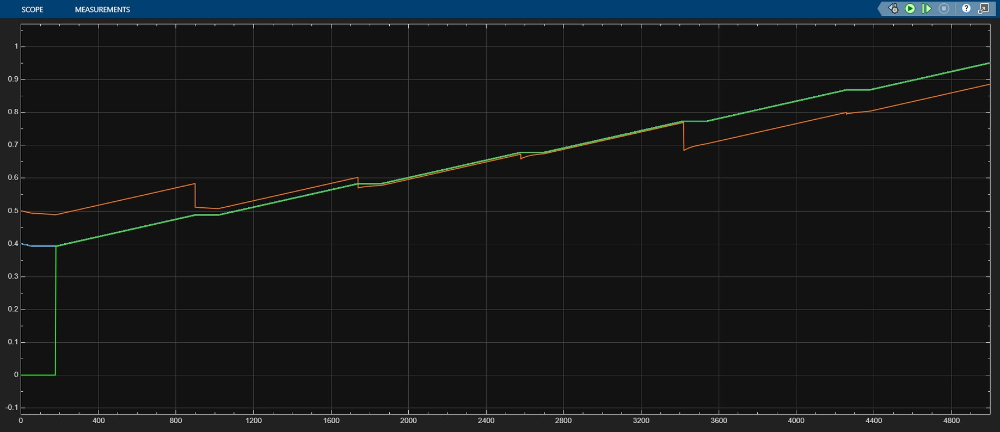

# LFP Smart Charger and SOC Estimation

I built a MATLAB/Simulink simulation of a constant-current/constant-voltage
(CC–CV) charger for a 16S1P, 105 Ah LiFePO₄ battery pack. My custom
Supervised-Gain Dual Kalman Filter (SG-DKF) estimates state of charge (SOC)
from pack voltage and current without communication with the battery
management system.

The charger inserts rest periods so the battery voltage can settle.
The estimator tracks charge by integrating current and uses voltage
feedback to correct the estimate.

## Intended use

This design is intended for factory charging stations that handle new
battery packs of a known type. It can be adapted to other battery types
by updating the battery model parameters and the charger’s current and
voltage limits, then validating the configuration for that pack.

The estimator assumes a fixed, known battery capacity. The intended use
is therefore with new packs whose capacity is close to the configured
nominal value. The starting state of charge can vary from pack to pack.

## Simulation results

Across six cases covering three starting SOC levels and two prior current
directions, SOC RMSE ranged from **0.0121 to 0.1830 percentage points**
against the simulated battery reference. The largest absolute SOC error
was **0.6973 percentage points** over the evaluated intervals.

## Model and battery pack

*40% starting SOC after discharge. Blue: simulated battery SOC. Green: SG-DKF. Orange: reference EKF.*
